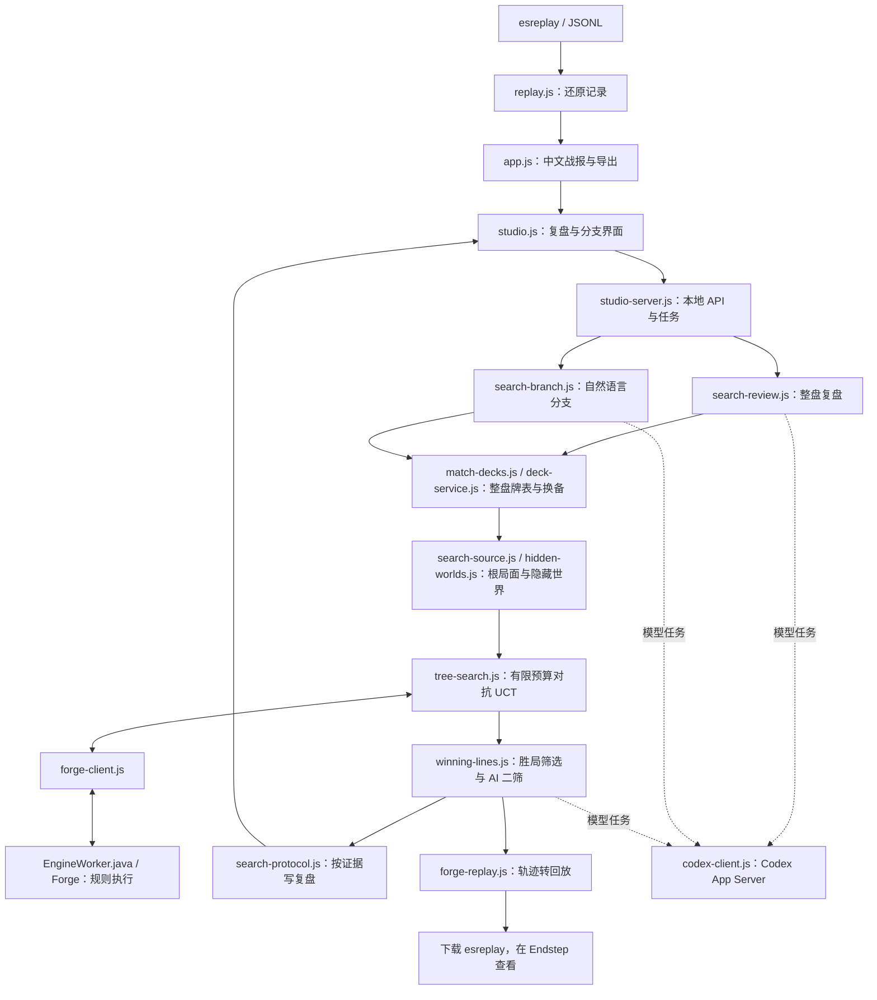

# 代码导览

这份文档面向准备阅读、修改或参与开发的人，按当前发布目录逐个解释文件，并拆解主要函数、类和逻辑块。“代码块”指承担一个任务的逻辑单元；重复字段与界面模板按用途合并说明。

项目做三件事：把 Endstep 文件还原成可读战报；用 Forge 搜索具体决策的替代路线；让 Codex 根据搜索证据生成复盘，并把认可的路线导回 Endstep。规则执行、模型判断和文件编码是三个独立环节。

## 1. 推荐阅读顺序

1. [README.md](README.md)：安装、使用方式和实验范围。
2. [studio-server.js](studio-server.js) 的 `createStudio()`：服务启动与任务分发。
3. [search-review.js](search-review.js) 的 `runForgeReview()`：整盘复盘主流程。
4. [tree-search.js](tree-search.js) 的 `search()`：选择动作、扩展、模拟与评分。
5. [forge/EngineWorker.java](forge/EngineWorker.java) 的 `restore()`、`Controller`、`execute()`：把局面交给 Forge。
6. [winning-lines.js](winning-lines.js) 与 [forge-replay.js](forge-replay.js)：保留路线并生成回放。
7. [studio.js](studio.js)：展示结果，选择节点和提出新打法。

更短的算法说明见 [studio-architecture.md](studio-architecture.md)。本文解释实现位置，架构文档解释流程约束。

## 2. 调用关系



浏览器负责交互；Node.js 负责解析、任务、搜索调度与编码；Java 进程加载 Forge 并执行规则。Codex App Server 单独提供模型调用。搜索循环本身不逐步请求模型。

## 3. 页面与阅读器

### [index.html](index.html)

页面骨架，提供 DOM 元素和按钮，具体数据由脚本填入。

- 导入区与比赛抬头：文件选择、玩家、赛制、局分和全屏等工具。选择器不限制扩展名，避免系统隐藏 `.esreplay`；由 `openFile()` 按 gzip 文件头与 Replay 内容校验。
- 阅读方式切换：整盘复盘、中文战报、原始 JSONL。
- 中文战报：左侧回合索引、中间事件、右侧局面；点击事件查看对应快照。
- 复盘区：任务进度、整盘概览、关键节点、资源检查、自然语言意图和下载结果。
- `manual-workflow`：旧版手动交接文件界面，默认隐藏。
- 弹窗与浮层：阅读说明、牌面文字、提示消息、拖放覆盖层。
- 脚本按 `replay → engine → branch → app → studio` 加载。当前使用普通脚本共享全局对象，没有前端打包器。

### [style.css](style.css)

全站样式与布局，各规则组分别负责：

- 基础变量、字体、颜色、边框、按钮、输入框。
- 比赛抬头、工具栏、三栏阅读区及滚动。
- 复盘侧栏、节点详情、证据、牌表、结果。
- JSONL、弹窗、旧手动区、空状态。
- 媒体查询、全屏布局及减少动态效果设置。

调整外观主要改这里；改变按钮行为要看 `app.js` 或 `studio.js`。

### [app.js](app.js)

阅读器的前端控制器，同时保留旧版文件交接界面。

| 逻辑块 / 函数 | 职责 |
| --- | --- |
| 全局 `model`、当前局/回合/事件状态 | 保存战报及阅读位置；`studio.js` 会复用这些状态 |
| `openFile()`、`loadModel()` | 读取文件、识别 gzip、解析记录，重置界面并通知工作台 |
| `switchView()` | 切换战报、复盘与 JSONL |
| `renderGames()`、`renderTurns()`、`renderReading()` | 绘制分局、回合和事件，支持关键词及精简/完整记录 |
| `cardRows()`、`renderBoard()`、`showCard()` | 展示区域中的牌、横置/指示物等状态及文件内牌面文字 |
| `chooseTurn()`、`moveTurn()`、`revealSelectedTurn()` | 回合定位与导航 |
| `renderRaw()` | 按类型或关键词预览原始行；筛选不改变原始导出 |
| `exportFile()`、`download()` | 导出 HTML、Markdown、TXT、JSONL、结构化 JSON |
| `prepareBranch()` 到 `exportBranch()` 等旧分支函数 | 手动交接、导入旧 `branch.json`、校验并编译有限规则片段 |
| 拖放、按钮和键盘监听 | 连接用户操作，处理全屏、搜索、提示和弹窗 |

事件中文描述来自 `replay.js`；本文件主要决定如何呈现。

### [studio.js](studio.js)

当前复盘功能的前端控制器。

| 逻辑块 / 函数 | 职责 |
| --- | --- |
| `state` | 保存连接、实际模型、源文件 ID、复盘、节点、意图、任务、证据和牌表 |
| `api()` | 请求本地后端，添加写请求标识并处理接口错误 |
| `controls()`、`renderJob()` | 根据登录、Forge 安装和任务状态控制按钮与进度 |
| `evidenceDetails()`、`renderOverview()` | 展示整盘结论、牌表/换备依据和搜索证据 |
| `renderNodes()`、`renderNode()`、`renderRoute()` | 绘制节点、分析、费用来源与具体新打法 |
| `preserveEdits()` | 按节点保留自然语言输入，并在会话存储中恢复 |
| `openNode()`、`locate()` | 从战报或复盘选节点，反向定位原始事件 |
| `renderResult()`、`acceptEvidence()` | 接受后端结果，展示保留理由及下载路线 |
| `submit()`、`watch()` | 提交 review/plan/branch，轮询并更新页面 |
| `onModel()`、`boot()` | 导入时注册对局，启动时恢复源文件和已有结果 |

用户输入自然语言；动作提炼与可执行性检查在后端完成。

### [replay.js](replay.js)

浏览器与 Node.js 共用的 Endstep Replay v1 解析器。

- `patch()`：把 `diff` 应用到已有状态，处理对象变化、删除与按身份更新的数组。
- `cardsIn()`、`lookup()`、`cardName()`：查区域/堆叠中的实体，隐藏牌保留未知。
- `shortCard()`、`snapshot()`：生成阅读器需要的精简快照。
- `modeText()`、`effectText()`、`describe()`：翻译事件，区分施放、结算、移区，保留英文牌名。
- `parse()`：按行消费文件头、chapter、key、diff、event、action，建立比赛、回合、事件、快照和牌面索引。点击记录不直接当成动作成功。
- `visible()`：区分精简/完整记录；`clock()`、`title()` 负责显示格式。
- `markdown()`：生成 Markdown 战报。
- 文件末尾：同时提供 CommonJS 导出与浏览器 `Replay` 对象。

它解释文件，不执行规则。搜索根所需的额外历史由 `search-source.js` 恢复。

## 4. 本地服务与模型连接

### [studio-server.js](studio-server.js)

应用入口和本地 HTTP 服务，`npm start` 从这里启动。

- `createStudio()`：组装 Codex、Forge、牌表服务、模型队列和任务表；允许测试注入替身。
- `register()`：解析并保存对局，以内容身份关联已有结果。
- `snapshot()`、`save()`、`progress()`：整理、持久化并返回任务进度与结果。
- `ask()`：通过队列提交结构化任务，记录排队与请求诊断，区分重试原因，推理/搜索恢复后更新提示。
- `review()`、`run()`：分发至 `runForgeReview()` 或 `runForgeBranch()`，处理完成、取消和失败。
- `body()`：限制并读取 JSON 请求体。
- HTTP 处理块：检查 Host、会话、来源和写请求标识，只开放白名单静态文件及 API。
- 启动/恢复块：监听本机，恢复源文件和任务，处理已中断任务，过滤过期结果。
- 文件末尾：直接运行时读取端口/可选对局参数，被导入时只导出 `createStudio()`。

| API | 用途 |
| --- | --- |
| `GET /api/health` | Codex 登录、实际模型/推理强度、Forge 安装状态 |
| `POST /api/replays` | 注册解压后的 JSONL |
| `GET /api/current` | 恢复源文件、复盘、证据、牌表及任务 |
| `POST /api/jobs` | 创建 `review`、`plan` 或 `branch` |
| `GET /api/jobs/:id` | 读取进度和结果 |
| `DELETE /api/jobs/:id` | 取消任务 |
| `GET /api/jobs/:id/replay`、`/jsonl` | 下载通过保留门槛的分支 |
| `GET /api/jobs/:id/nodes/:sourceLine/replay` | 下载整盘复盘已保留的节点路线 |

下载门槛在服务端也检查。未获认可的胜局、失败路线和未终局路线不能从当前产品接口下载。

### [codex-client.js](codex-client.js)

本机 Codex App Server 的适配器，不自行处理账号密码。

- `connect()`、`start()`：初始化并复用 stdio 子进程；默认读取提供方配置，为未自定义的官方账号选择独立 HTTP/SSE 提供方，避免 WebSocket 握手超时，不改写全局配置。自定义提供方保持原路由。
- `send()`、`request()`：发送 JSON-RPC，按 ID 配对响应和超时。
- `receive()`：分发响应、消息、错误与完成，将输出归属到任务；按错误类型区分重连/限流/上游重试，推理和工具活动恢复后清除提示，拒绝不需要的工具授权请求。
- `status()`：读取账号连接和配置，返回实际模型信息。
- `generate()`：建立临时模型会话，设置结构化输出、指令、取消和可选网页搜索，组装回答，记录请求起止、重试和恢复时间。
- `errorDetails()`、`redact()`：提取错误类型/HTTP状态并脱敏；诊断不保存原始推理或凭据。
- `fail()`、`close()`：进程退出时结束等待请求、清理资源。

当前模型任务关闭 shell、应用、MCP 和其他代理；牌表/换备任务可单独开启网页搜索。模型分析不会自动获得整个工作区的操作权。

### [model-queue.js](model-queue.js)

`createModelQueue(limit)` 返回排队函数。内部 `drain()` 在空闲时启动下一个任务，限制并发；排队任务可取消。服务默认限制模型并发，避免同时提交过多长任务。

## 5. 整盘复盘与自然语言分支

### [search-review.js](search-review.js)

当前整盘复盘编排器。

- `ensureMatchDecks()`：整盘只准备一次牌表/换备，复用已有结果。
- `seeds()`、`buildWorlds()`：生成可复现种子，从固定列表构造隐藏世界。
- `prepareNode()`：准备节点根局面、规则目录和世界，检查能否恢复。
- `compactEvidence()`：整理前端和模型需要的紧凑搜索证据。
- `writeWinningReplays()`：只为已保留路线编译节点回放。
- `runForgeReview()`：读缓存、让模型挑研究节点、优先覆盖每局、逐节点搜索、汇总不支持原因，再集中做胜局二筛。
- 内部 `ground()` 及校验/修复块：将自然语言结论绑定真实节点与搜索，核对来源、实体和费用。无保留改进的节点不能凭文字定为已证实失误；校验失败时有限局部修正。
- 结果写入块：保存复盘、证据、下载地址和带版本缓存。

“值得研究”只是候选问题，搜索之后才有支持结论的证据。

### [search-branch.js](search-branch.js)

处理选定节点后的自然语言想法。

- `intentPrompt()`：将节点、用户输入、已有分析和引擎选项交给模型，提炼受限目标。
- `planView()`：把结构化目标和预演整理成可读新打法。
- `runForgeBranch()`：恢复节点、复用牌表、提炼或复用意图，核对牌名及冲突，进行局部预演；`plan` 返回预演，`branch` 继续搜索。
- 搜索/导出块：寻找满足意图的路线，经二筛和一致重放再保存回放，失败原因进入诊断。

可表达施放、起动、下地、让过和有范围的避免动作；不能直接改生命、指定未来必抓某牌或强迫对手配合。对手按新局面继续决策。

### [search-protocol.js](search-protocol.js)

当前搜索复盘提示词。

- `instructions`：英文牌名、证据及假设边界等共同要求。
- `shortlistPrompt()`：通看时间线，输出研究节点、问题、替代思路及优先级。
- `summarizeEvidence()`：压缩真实搜索、支付、终局和筛选信息。
- `reviewPrompt()`：依据证据写整盘复盘、资源审计和具体建议，区分事实与假设。

改变“怎样解释复盘”主要改这里；合法动作要由引擎适配处理。

### [search-schema.js](search-schema.js)

当前模型任务的严格 JSON Schema。

| 定义 | 内容 |
| --- | --- |
| `deck` | 类型、公开来源、日期、依据、主备牌与张数 |
| `deckSelection` | 本地候选的现有 ID、类型、选择理由或无合理候选 |
| `shortlist` | 事件行、优先级、问题、替代线和原因 |
| `intent` / `goal` | 用户意图、支持情况、有序目标、模式/目标及避免动作范围 |
| `sideboarding` | 分局成对换入换出、数量、理由与不确定性 |
| `winningSelection` | 保留哪个真实候选、理由、风险与置信度 |
| `object()`、`array()`、`enumeration()` 等 | 构造严格字段与类型约束 |

结构通过不等于规则合法，后面还有实体检查、Forge 执行和结果验证。

## 6. 牌表、隐藏信息与根局面

### [match-decks.js](match-decks.js)

建立双方整盘牌表及分局换备后的组成。

- `scanMatch()`：按实体统计公开牌，汇总跨局数量约束，提取录制完整牌表和 `SIDEBOARD_SUBMIT`。
- `fixDeck()`：按录制张数增减主牌，缩减时保留整盘已公开的最低数量，并记录修正。
- `coverGlobalFacts()`：补齐整盘公开牌的最低数量，优先用这些牌补足参考列表缺少的主牌位置。
- `prepareMatchDecks()`：优先用已录制己方列表，其余通过牌表服务；将双方完整主备、先后手与约束交给换备 AI。
- 内部换备应用/校验：核对实体与张数，形成每局固定列表，己方实际换备与 AI 建议分别保存。

允许整盘公开信息事后还原组成，但不能把未来出现的牌当成过去确定手牌。

### [deck-service.js](deck-service.js)

公开牌表的检索、下载、校验与缓存。

- `canonicalName()`：规范空格和标点。
- `parseDeck()`：解析主备牌文本与数量。
- `downloadDeck()`：从允许主机下载，检查地址、大小与超时。
- `readDeckPreferences()` 读取每位玩家选择的来源，解析上传的英文纯文本牌表。
- `DeckService` 按选择查本地目录或让 AI 联网。联网参考由后端独立下载核对。本地模式直接使用牌表库的排名，旧版客户端仍可使用自动回退。失败状态区分查询无结果和来源核对失败。

模型给出链接后，程序仍核验实际下载内容。

### [deck-catalog.js](deck-catalog.js)

- `cards()`、`normalizeDeck()`：合并实体数量，核对构筑主备牌、日期、MTGO来源与哈希，按组成生成 ID。
- `rankCandidates()`：按赛制和日期过滤。整盘参考主牌最多相差 3 张，评分以已观察牌的稀有度和数量覆盖为主，并对张数差距扣分。
- `DeckCatalog.load()`、`find()`：校验并合并内置/本机快照，去重后返回有限候选。
- `syncCatalog()`：固定上游仓库和提交，读取月份目录、下载有限赛事文件，校验 Git blob 及 SHA-256，原子写入快照；没有有效数据时保留原文件。
- CLI入口：`npm run update:decks` 更新私有数据目录；维护者可用 `--output` 更新发布快照。

### [data/deck-catalog.json](data/deck-catalog.json)

随源码提供的公开 Legacy 参考库。保存列表、赛事来源、提交版本、来源哈希与快照完整性哈希；不含用户对局，不是对手的真实牌表。

### [data/README.md](data/README.md)

说明公开数据来源、当前覆盖范围、快照数量、更新命令及来源许可链接。

### [search-source.js](search-source.js)

把源事件行转成“操作之前”的搜索输入。

- `sourceAt()`：恢复分歧前状态、身份、相关历史、抓牌/下地/施法次数及已知库顶。
- 按局重置与前缀扫描：避免跨局身份混用或把未来牌序带回过去。
- `candidates()`：提取供模型研究的决策节点和简述。

`sourceLine` 是原始 JSONL 的一基行号，不是前端列表下标或回合数。

### [hidden-worlds.js](hidden-worlds.js)

构造同一节点中显式假设的手牌与牌库顺序。

- `random()`、`shuffle()`：有种子的可复现排列。
- `cardText()` 及支持性检查：识别可恢复机制，缺口报 `unsupported_root`。
- `buildWorld()`：从固定牌表减去已知实体，填充未知区域，保留已知库顶；可构造标注的交互压力情景。
- `auditRoot()`：核对 Forge 根与源事实的生命、区域、身份、数量及重要历史等。

默认多个世界使用同一牌表，仅改变未知手牌与顺序。它们不是带概率的真实分布，不能由此计算胜率。

## 7. 搜索与胜局筛选

### [tree-search.js](tree-search.js)

有限预算的对抗 UCT，不是把全部高亮动作穷举到底。

- `deduplicate()`：合并相同候选。
- `rankActions()`：启发排序并限制宽度，同时保留 pass；部分合法动作不会进入本次树。
- `originalSelection()`：将原记录根操作匹配到引擎候选，建立比较基线。
- `Node`：保存路径、父子节点、状态、候选、访问数、奖励与拒绝动作。
- `search()` 准备块：合并预算，每个世界独立建树，并建立路径模拟缓存。
- 选择/扩展：按 UCT 分配探索预算，己方最大化收益，对手最小化收益。
- 模拟：Forge 执行路径，再用原生策略续局；限制回合、决策和引擎步数。
- 回传：终局胜/负/和奖励 `+1/-1/0`，未终局材料启发值限制在 `±0.25`，更新访问数据。
- 汇总：返回独立模拟统计、根动作比较、唯一胜局和无效路径等证据，同时记录整节点与各隐藏世界的 `elapsedMs`。

默认整盘节点每世界 32 次迭代、宽 7、深 7；意图分支 40 次、宽 7、深 9。各世界独立树，尚非完整信息集 MCTS。材料分、采样次数和模型置信度都不是胜率。

### [winning-lines.js](winning-lines.js)

判断搜到的胜局是否值得指导原局。

- `won()`、`summarize()`：识别引擎终局，压缩资源与动作证据。
- `finalists()`：按真实执行序列和世界去重，选有限且多样的决赛候选。
- `selectWinningLines()` 基线块：在同一世界执行原操作，再由 Forge 策略续局；不是照搬原录像的全部未来。
- AI 二筛：批量比较候选、基线及反例，判断更稳、优势与教学价值，允许全部不保留。
- 重放验证：重新采集认可路线完整轨迹，核对胜者、终局回合和执行序列一致。
- 结果绑定：保留理由、风险、选中根动作及轨迹绑定到节点。

搜索获胜、AI 认可、重放一致后才提供推荐下载。结论仍以对应隐藏信息假设为条件。

## 8. Forge 桥接与回放编码

### [forge-client.js](forge-client.js)

Node.js 与 Java Worker 的桥。

- 构造函数、`status()`：定位便携运行时并检查安装。
- `connect()`、`start()`：按 Java 源码哈希决定是否编译，组装类路径，启动并等待 ready。
- 标准输出读取：解析协议 JSONL，按 ID 分发响应，引擎日志另存。
- `request()`：排队执行 `catalog/expand/simulate`，处理超时、取消及故障。
- `fail()`、`close()`：清理未完成请求与进程，后续可重建连接。

同一 JVM 串行执行，因为 Forge 的 `MyRandom` 是全局状态。模型任务并行不等于规则模拟可以在该 JVM 中并行。

### [forge/EngineWorker.java](forge/EngineWorker.java)

规则适配核心，依赖下载的 Forge 运行时，不是 Forge 本体源码。

| 类 / 方法块 | 职责 |
| --- | --- |
| JSON、区域常量、`str/num/bool/field/require` | 协议读取、字段恢复和错误处理 |
| `Boundary`、`InvalidAction` | 区分“下个决策边界”和“路径动作无效” |
| `Loader extends GameState` | 同步加载根，关联原记录与 Forge 实体 |
| `Choice` | 引擎选择与对外动作说明 |
| `Context` | 保存游戏、实体映射、路径、目标、世界、轨迹和执行记录 |
| `Context` 目标匹配/限制/完成检查 | 将用户目标与动作匹配，处理顺序、避免动作及产费准备 |
| `Controller extends PlayerControllerAi` | 在优先权边界接管，执行路径/目标，再交原生策略续局 |
| 控制器模式/施放处理 | 应用指定模式、调用实际施法和费用流程，采集决策及结果帧 |
| `restore()` | 恢复玩家、牌库、区域、生命、回合、历史、优先权、部分衍生物等 |
| `restoreStack()` | 恢复支持的普通堆叠法术、模式和目标，范围外失败 |
| `card()`、`snapshot()` | 将 Forge 状态投影成 Node/回放所需字段 |
| `parts()`、`applyTargets()` | 遍历异能链并绑定实际目标 |
| `targetOptions()`、`targetProducts()` | 枚举有限目标组合 |
| `candidates()` | 枚举部分施法、起动、下地、模式、目标、X 和 pass |
| `evaluation()` | 输出终局及快速材料评价 |
| `catalog()` | 返回规则元数据 |
| `execute()` | 每请求重建根并执行路径，驱动 `mainLoopStep()` 到决策或预算边界 |
| `main()` | 初始化无界面 Forge，逐行处理 JSON 请求/响应，普通日志转 stderr |

协议命令：

- `catalog`：查牌目录。
- `expand`：执行路径，停在下一个决策边界，返回状态及候选。
- `simulate`：执行路径并续局到终局/预算边界，返回评价，可附完整轨迹。

每次请求从审计根重建并重放路径，没有使用 `GameCopier`：早先实测其复制过程会丢本回合抓牌历史。这减少复制带来的状态丢失，但仍受根恢复覆盖范围限制。

当前不能完整恢复所有附件、持续效果、徽记、堆叠异能、战斗声明、地下城或昼夜状态，范围外应拒绝该根。支付、战斗和部分选择沿用 Forge 策略，枚举也有预算边界。

### [forge-replay.js](forge-replay.js)

将真实 Forge 轨迹写成 Endstep 文件。

- `difference()`：生成兼容差分，保留删除信息。
- `visibleState()`：投影视角、隐藏对手手牌、映射阶段和状态。
- `paymentText()`：将实际支付来源转为文字。
- `routeFromTrace()`：从实际动作、模式、目标、支付生成可读路线。
- `compileReplay()` 前缀块：绑定源文件，保留分歧前记录，截断原未来。
- 内部 `event()`、`emit()`：写事件、周期完整快照和差分，保留供 Endstep 定位的决策帧。
- 假设/终局块：记录世界、种子、来源、二筛及假设，更新假设终局与局分。
- 输出检查：检查大小、重新解析，返回 JSONL 和压缩文件。

底层编码器也支持兼容/测试用片段；当前产品下载另受胜局二筛控制，编码成功不等于推荐。

## 9. 共享校验与旧版兼容

以下文件保留早期实现，其中公共解析/校验仍被新流程复用。旧账本生成与有限规则编译不承担当前 Forge 主流程。

### [studio-schema.js](studio-schema.js)

- 定义整盘复盘、节点修复、概览、资源审计、具体打法及旧分支/审核结构。
- `validate()`：递归检查类型、字段、数组、必填、枚举和允许分支。
- 当前复盘复用 `review/reviewPatch`；`branch/verification/extractedPlan` 等还服务旧流程。

### [studio-protocol.js](studio-protocol.js)

- `preActionState()`、`context()`、`conciseState()`：整理上下文与操作前状态。
- `validateReview()`：检查事件、玩家、资源实体与牌名，当前搜索复盘仍使用。
- `reviewPrompt()`、`reviewAuditPrompt()`、`reviewRepairPrompt()`：早期直接复盘和审核/修正提示词；当前主提示词在 `search-protocol.js`。
- `extractPrompt()`、`branchPrompt()`、`verificationPrompt()`：旧意图提炼、账本推演与审核协议。

### [scenario.js](scenario.js)

- `sourceAt()`、`digest`：读取源节点与内容身份，当前源绑定等仍复用。
- `cleanCard()`、`initialization()`：初始化旧假设账本的牌、手牌和牌库。
- `compile()`：应用旧账本的抓牌、施法、移区、生命、指示物等命令。
- 内部不变量、费用和动作块：检查账本局部一致性。

这不是完整规则引擎；当前 Forge 失败后不会退回旧账本制造完整对局。

### [review-runner.js](review-runner.js)

旧的模型先逐局复盘流程。

- `runReview()`：逐局生成、校验、独立资源审核、修复并汇总。
- 内部 `publish()`、`stage()`：发布阶段结果与进度。
- 缓存和重试：复用旧结果，限制修正次数。

当前服务默认使用 `runForgeReview()`，这里保留兼容与回归测试。

### [engine.js](engine.js)

旧浏览器分支的有限规则执行器，导出 `BranchEngine`。

- `find()`、`move()`、`target()`：定位、移区、检查有限目标。
- `manaColors()`、`pay()`：支持范围内的产费和支付。
- `legalCard()`、`push()`、`draw()`：有限手牌、堆叠、抓牌与触发处理。
- `apply()`：执行有限下地、施法、结算、找地动作。
- 硬编码的牌/规则块：早期局部示范，不代表通用规则支持。

新增当前搜索支持应改 Forge 恢复/候选适配，不能只向这里添加牌名。

### [branch.js](branch.js)

旧手动交接与有限分支编译库，浏览器和 Node 共用。

- `linesOf()`、`hash()`：读取源行与内容绑定。
- `decisions()`、`baseline()`：列分支起点、取前缀和已知实体。
- `handoff()`、`prompt()`：生成交接文件与提示词。
- `validate()`、`checkState()`：检查旧协议、状态及隐藏信息边界。
- `compile()`：调用有限 `BranchEngine`，写原前缀后的事件/快照，超出范围停止。

### [branch.schema.json](branch.schema.json)

旧 `branch.json` 的字段、来源、起点、假设、步骤和动作约束，服务手动交接与有限编译。当前意图和胜局二筛接口在 `search-schema.js`。

### [branch-protocol.md](branch-protocol.md)

旧手动交接说明：输入、动作格式、前缀绑定、隐藏信息、停止条件与用法。执行能力按旧有限执行器理解；当前自动工作流以 README 和架构文档为准。

### [branch-cli.js](branch-cli.js)

旧编译器命令行包装：读并解压原文件，读计划，调用 `Branch.compile()`，gzip 压缩并检查大小后写文件，错误返回非零退出码。

```powershell
node branch-cli.js 原回放.esreplay branch.json 输出.esreplay
```

这不会启动当前 Forge 搜索或自动请求 Codex。

### [card-lookup.js](card-lookup.js)

旧账本使用的 `Cards` 类。`get()` 依次查记录内牌面、本地缓存和 Scryfall，转换成旧执行器字段。当前规则目录来自 Java `catalog()`。

## 10. 安装、启动与构建

### [package.json](package.json)

声明项目、版本、Node 最低版本和命令。`private: true` 防止误发 npm，不决定 GitHub 是否公开。

| 命令 | 内容 |
| --- | --- |
| `npm start` | 启动本地服务 |
| `npm test` | 用 Node 内置测试运行器执行 `tests/*.test.js` |
| `npm run test:forge` | 真实 Forge 桥接自检，不调用 AI |
| `npm run build` | 单文件离线阅读器 |
| `npm run update:decks` | 同步公开赛事参考库到本机数据目录，不调用模型 |

目前没有 npm 运行依赖，Forge、JDK 和本机 Codex 是单独运行时。

### [启动复盘.cmd](启动复盘.cmd)

双击入口，调用同目录 `start.ps1`，保留窗口显示启动信息。

### [start.ps1](start.ps1)

- 建立 `.endstep-data`，检查默认 `8787` 端口是否已有本应用。
- 定位 Node，接受可选初始对局路径。
- 隐藏启动服务，把日志和 PID 写入数据目录。
- 轮询就绪，输出地址或错误。
- `-Restart`：先检查当前任务，运行中拒绝重启；核对 PID 与服务完整路径后，仅停止本安装的服务及其 Java/Codex 子进程，再启动新版本。

双击启动器使用默认端口；开发时可给服务设置 `PORT` 改端口。

### [重启复盘.cmd](重启复盘.cmd)

调用 `start.ps1 -Restart`，用于更新后加载新后端；不会自动中断运行中的复盘。

### [安装Forge.cmd](安装Forge.cmd)

双击安装入口，调用 `forge/setup.ps1` 并保留窗口查看结果。

### [forge/setup.ps1](forge/setup.ps1)

调用下载器、检查状态、解压便携 JDK/Forge、写完成标记。运行时在 `%LOCALAPPDATA%\EndstepForgeProbe`，不修改系统 Java。

### [forge/download-runtime.cjs](forge/download-runtime.cjs)

- `assets`：固定官方归档地址、大小和 SHA-256。
- `get()`：校验已有完整包，或解析官方下载位置、分块下载并续传。
- 合并/校验块：拼接归档、核对大小和哈希，失败报错。
- 入口：获取全部所需运行时。

升级要一起核对版本、哈希、目录和 Java API 兼容，不能只换链接。

### [build.js](build.js)

- 内联 CSS 和五个页面脚本，输出 `dist/Endstep对局档案.html`。
- 可选对局路径参数会嵌入对局并导出 Markdown/JSONL；该旧辅助分支目前使用固定示例牌文件名。
- 默认无参数构建不含个人对局。离线页支持阅读/导出，复盘连接需要本地服务。

## 11. 测试各自验证什么

### [tests/replay.test.js](tests/replay.test.js)

验证差分、身份数组、事件解释、解析与导出，可选私有样本。防止把点击等同成功动作或把隐藏信息补进过去。

### [tests/branch.test.js](tests/branch.test.js)

验证旧有限分支、源绑定、支付与停止边界，可选官方解码器。不能据此声称 Forge 已支持全部规则。

### [tests/codex-client.test.js](tests/codex-client.test.js)

验证输出拼接、消息归属、错误脱敏、限流/上游/连接分类，以及推理和网页搜索活动能清除旧重试提示；不能代替真实连接或模型质量评估。

### [tests/deck-catalog.test.js](tests/deck-catalog.test.js)

验证部分公开信息的匹配、主备范围和数量约束、快照完整性、来源哈希、固定候选选择与缓存，以及同步损坏数据不能覆盖有效库。

### [tests/studio.test.js](tests/studio.test.js)

验证共享复盘来源/资源校验、旧逐局修复与缓存，以及 HTTP 替身流程、会话/来源、取消、恢复和下载门槛；替身不执行真实规则。

### [tests/search.test.js](tests/search.test.js)

验证根历史、库顶、固定牌表、候选和费用证据，以及轨迹编码的差分、手牌隐藏、决策和终局投影。部分实际样本/官方解码检查需环境变量。

### [tests/winning-lines.test.js](tests/winning-lines.test.js)

验证 UCT 奖励、缓存、唯一胜局、对手最小化、无胜局不二筛、AI 全拒绝、候选身份、一致重放及选中根动作比较。

### [forge/self-test.cjs](forge/self-test.cjs)

真实引擎自检，使用无用户隐私的 Lightning Bolt 终结局面，验证恢复、红色费用、目标、历史与获胜终局，不请求模型。

格式测试、协议替身、真实引擎和样本解码各有覆盖范围，不能互相代替。

## 12. 其他文件与本地目录

### [README.md](README.md)

仓库首页：目的、安装、牌表/换备、算法边界、数据及测试，面向使用者。

### [studio-architecture.md](studio-architecture.md)

当前流程的设计约束、预算、事实/假设、搜索/二筛、缓存和进程边界。

### [code-guide.md](code-guide.md)

本文。新增文件、修改入口或替换主流程后应同步维护。

### [.gitignore](.gitignore)

忽略本地数据、构建、依赖、回放和常见交接文件。已提交文件不会自动被清除，发布前仍需查看实际跟踪列表。

### [.nojekyll](.nojekyll)

发布目录中的空标记，告诉 GitHub Pages 不经过 Jekyll；没有运行代码，也不能让 Pages 执行 Node/Java/Codex 后端。

运行时生成、不应随源码发布的内容：

| 位置 | 内容 |
| --- | --- |
| `.endstep-data/` | 源文件、模型输入输出、进度、诊断、轨迹、复盘和输出 |
| `.endstep-data/deck-profiles/` | 整盘牌表、来源与换备 |
| `.endstep-data/forge-reviews/` | 带版本复盘缓存 |
| `.endstep-data/jobs/` | 任务、搜索证据和认可回放 |
| `.endstep-data/jobs/<任务ID>/model-requests.jsonl` | 排队、模型请求时间、脱敏错误类型/状态、重试与恢复 |
| `.endstep-data/jobs/<任务ID>/progress.jsonl` | 完整阶段进度；区别于页面只保留最近100条 |
| `.endstep-data/deck-catalog.json` | 手动更新的公开牌表库，与内置快照合并查询 |
| `dist/` | 离线构建；带样本构建还包含对局内容 |
| `%LOCALAPPDATA%\EndstepForgeProbe` | JDK、Forge、下载分块及便携运行时 |

个人工作区可能另有截图、`inspect-match.js`、`make-branch-example.js` 和 `forge-probe/`，属于样本检查或早期实验，不在当前公开发布目录，也非运行必需。

## 13. 想改功能，先找哪里

| 行为 | 修改入口 | 还要核对 |
| --- | --- | --- |
| 视觉、全屏、窄屏 | `style.css`、`index.html` | 脚本 DOM 引用 |
| 事件翻译 | `replay.js` | 解析测试和源事实 |
| 节点、输入、下载按钮 | `studio.js` | 服务结果和下载门槛 |
| API、任务、取消、持久化 | `studio-server.js`、`model-queue.js` | 客户端取消与恢复 |
| 模型协议 | `codex-client.js` | 协议测试及实际 Codex 版本 |
| 复盘提示词与解释 | `search-protocol.js` | schema 与共享校验 |
| 新玩法目标 | `search-branch.js`、`search-schema.js` | Java 匹配/执行能力 |
| 搜索预算、奖励 | `tree-search.js` 和两个 runner | 耗时、独立模拟与证据 |
| 胜局保留标准 | `winning-lines.js` | 服务门槛及一致重放 |
| 牌表与换备 | `deck-service.js`、`match-decks.js` | 来源、数量与实体约束 |
| 隐藏手牌/库序 | `hidden-worlds.js` | 固定组成、已知库顶及假设 |
| 根状态/机制支持 | `search-source.js`、`hidden-worlds.js`、`EngineWorker.java` | 根审计与真实 Forge 样本 |
| Endstep 显示与动作定位 | `forge-replay.js` | 官方解码与实际加载 |

新增玩法目标需要模型能提炼、schema 能表达、Java 能执行、证据能解释、回放能投影。仅增加提示词不能完成整条链路。
